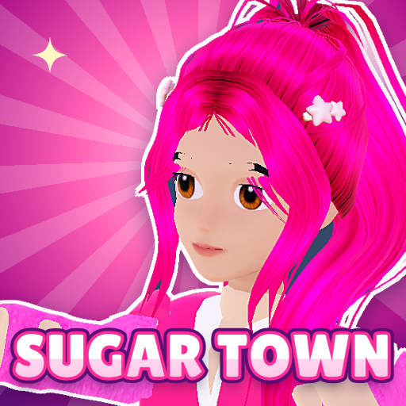
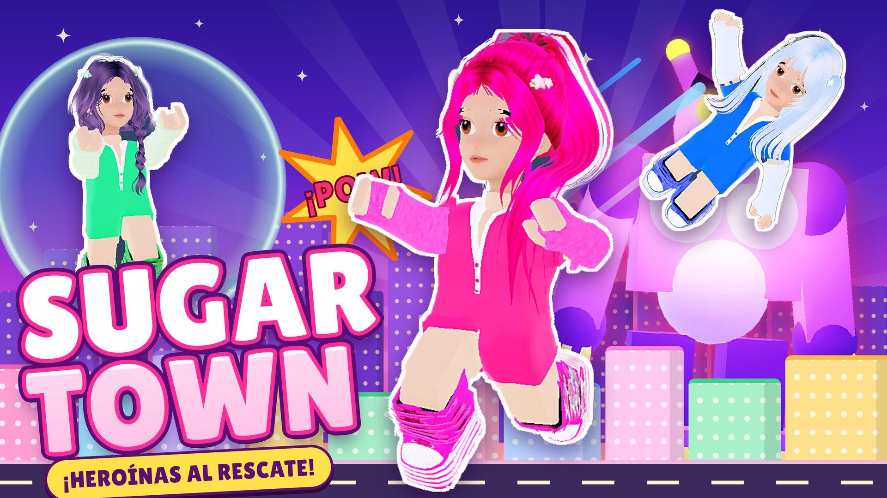
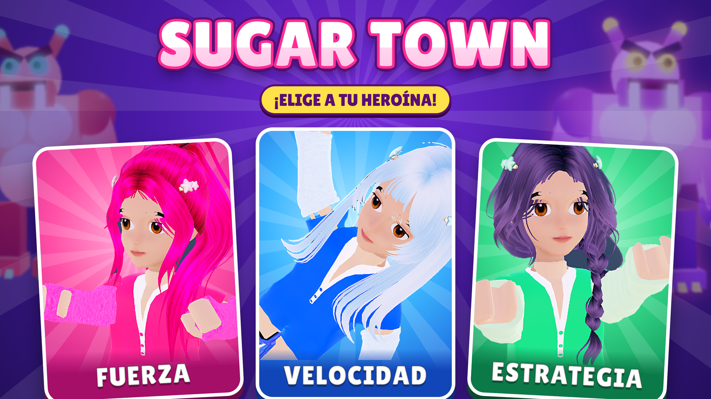

<p align="center">
  
</p>

<h1 align="center">Sugar Town: Heroínas al Rescate</h1>

<p align="center">
  Juego de Roblox de <b>acción cooperativa</b> y <b>defensa de base</b>.<br>
  Elige a tu heroína, vuela por una ciudad de colores y frena a los monstruos gigantes antes de que la destruyan.
</p>

<p align="center">
  
  
  
</p>



## 🎮 El juego

Los monstruos gigantes atacan Sugar Town en oleadas. Las jugadoras forman un equipo, vuelan por la ciudad y los derrotan antes de que derriben los edificios. Cada cinco oleadas aparece un jefe. Si caen todos los edificios, la partida termina y la ciudad vuelve a empezar.



### Las tres heroínas

| Heroína        | Color | Estilo de juego                                   |
|----------------|-------|---------------------------------------------------|
| **Fuerza**     | Rojo  | Mucho daño cuerpo a cuerpo y golpes de área       |
| **Velocidad**  | Azul  | El vuelo más rápido y ataques en ráfaga           |
| **Estrategia** | Verde | Escudos, ralentiza a los monstruos y apoya al equipo |

### Progresión de poderes

| Nivel | Poder |
|-------|-------|
| 1 | Combo de golpes cuerpo a cuerpo |
| 2 | Láser por tiempo (dura 120 s y luego recarga) |
| 3 | **Rayo Láser** ilimitado del color de tu heroína (se carga y atraviesa la línea) |
| 5 | Poder único: **Onda de Choque** (Fuerza) · **Impulso Relámpago** (Velocidad) · **Esfera Escudo** (Estrategia) |

### Más cosas

- **Lobby** con plataformas SOLO / DÚO / ESCUADRÓN para entrar en partida.
- **Rescate**: si caes, una compañera puede salvarte.
- **Armas** desbloqueables: Lanzador de Dulces, Martillo de Caramelo y Varita de Estrellas.
- **Mejoras** de daño y vuelo para cada heroína, compradas con monedas.
- **Tubo de Esencia Estelar**: una recompensa por tiempo que da más monedas.
- **Bonus por jugar con amigos**: ganas más monedas cuantas más amigas haya conectadas.
- **Tráfico** en las calles: si un coche te choca, te quedas mareada un momento.
- **HUD adaptable** para PC, móvil y mando.

### Controles

| Acción | Teclado / ratón | Mando | Móvil |
|--------|-----------------|-------|-------|
| Moverse / volar en una dirección | WASD o flechas | Stick izquierdo | Joystick |
| Activar / desactivar vuelo | F o doble Espacio | Y o doble A | Botón VOLAR |
| Turbo en vuelo | Shift | — | — |
| Golpe (combo) | Clic izquierdo | X | Botón GOLPE |
| Láser por tiempo | R | R1 | Botón del láser |
| Rayo Láser | Q | L2 | Botón Q |
| Poder único | E | R2 | Botón E |
| Usar arma | T | L1 | Botón ARMA |
| Cambiar de arma | 1 · 2 · 3 | — | — |

## 🛠️ Desarrollo

El código se escribe en **Luau estricto** (`--!strict`) y se sincroniza con Roblox Studio mediante [Rojo](https://rojo.space).

### Requisitos

- [Roblox Studio](https://create.roblox.com/)
- [Aftman](https://github.com/LPGhatguy/aftman), que instala la versión correcta de Rojo (ver `aftman.toml`)
- El plugin de Rojo para Roblox Studio

### Puesta en marcha

```bash
# 1. Instala las herramientas (Rojo 7.7.1)
aftman install

# 2. Genera el archivo del lugar
rojo build -o SugarTown.rbxlx

# 3. Abre SugarTown.rbxlx en Roblox Studio y arranca el servidor de Rojo
rojo serve
```

En Studio, conecta el plugin de Rojo y pulsa **Play**. La ciudad, el lobby y los edificios se generan por código al iniciar.

### Estructura del proyecto

```
src/
├── shared/   → ReplicatedStorage.Shared              (módulos compartidos)
│   ├── Config/        Heroínas, poderes, monstruos, armas, mejoras, sonidos…
│   ├── Remotes.luau   Todos los RemoteEvents/Functions en un solo sitio
│   ├── Trafico.luau   Posición de los coches según la hora del servidor
│   └── Types.luau     Tipos compartidos
├── server/   → ServerScriptService.Server             (lógica autoritativa)
│   ├── init.server.luau   Punto de entrada
│   ├── HeroinaService, CombateService, MonstruoService, EdificioService
│   ├── RondaService, LobbyService, RescateService, TraficoService
│   └── DatosService, MejorasService, MonetizacionService
└── client/   → StarterPlayerScripts.Client            (entrada y efectos visuales)
    ├── init.client.luau   Punto de entrada
    ├── VueloController, PoseVueloController, CombateController
    ├── PoderesController, ArmasController, RescateController
    └── UIController, CamaraController, EfectosController, TraficoController
```

### Arquitectura

- **El servidor manda.** Aplica el daño, controla la vida de monstruos y edificios, da las recompensas y guarda el progreso. El cliente solo envía *intenciones* (por ejemplo "usar el poder X apuntando a Y") y el servidor las valida: tipo de dato, distancia, enfriamientos y nivel.
- **Datos separados de la lógica.** Todos los valores de equilibrio están en `src/shared/Config/`.
- **Guardado seguro.** DataStore con reintentos, autoguardado y `BindToClose`. Si la carga falla, no se sobrescriben los datos de esa jugadora.
- **Compras idempotentes.** `ProcessReceipt` registra cada compra para no entregarla dos veces.

## 🎨 Propiedad intelectual

Todo el contenido de Sugar Town es **original**: personajes, nombres, ciudad, monstruos y diseños. No usa personajes, logotipos ni recursos de franquicias existentes.
